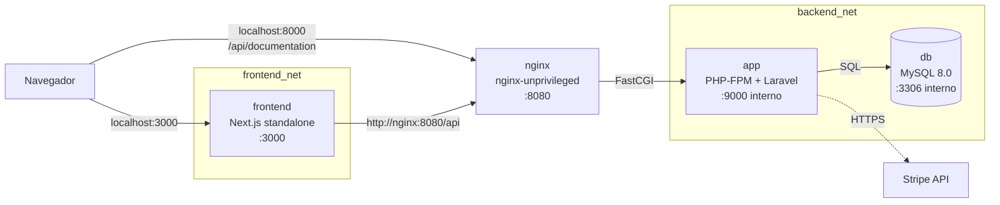

# Ecosistema e-commerce en Docker — imágenes multi-stage para producción

*Ingeniería de Imágenes Eficientes: Refactorización Multi-stage y Optimización de Capas en Docker*

Este repositorio contiene un ecosistema de tres servicios, listo para producción y levantable con **un solo comando** (`docker compose up -d --build`):

| Servicio | Origen (bootcamp) | Tecnología |
| --- | --- | --- |
| **Frontend** | [Tarea 17](https://github.com/JaimeGD07/tarea17-e-Commerce-Implementacion) | Next.js 16 (App Router, TypeScript, Tailwind v4) |
| **API REST** | [Tarea 12](https://github.com/JaimeGD07/tarea12-ecommerce-api) | Laravel 12 (JWT, Stripe, Swagger) sobre PHP-FPM + Nginx |
| **Base de datos** | — | MySQL 8.0 (imagen oficial) |

El trabajo de esta tarea no es la aplicación, sino **cómo se empaqueta**: separar construcción y ejecución con builds multi-stage, reducir el tamaño de las imágenes, minimizar la superficie de ataque y aprovechar el caché de capas.

## Resultados de un vistazo

| Imagen | Antes | Después | Reducción |
| --- | --- | --- | --- |
| Backend (PHP) | 827 MB (imagen de desarrollo de la Tarea 12) | **210 MB** | **−75 %** |
| Frontend (Next.js) | 2.74 GB (Dockerfile de una sola etapa sobre `node:22`) | **297 MB** | **−89 %** |
| Nginx | — | **73.7 MB** | — |

Los tres contenedores propios (`app`, `nginx`, `frontend`) corren **sin root**; las imágenes del backend y del frontend no contienen Composer, git, compiladores, pnpm ni código fuente; y solo se publican dos puertos en el host. Detalle y metodología en [Resultados y medición](#resultados-y-medición).

---

## Arquitectura



- **Un solo punto de entrada a la API:** Nginx. PHP-FPM (`app`) y MySQL (`db`) no se publican al host.
- **Dos redes aisladas.** `frontend_net` conecta el frontend con Nginx; `backend_net` conecta Nginx, la app y la base de datos. Nginx está en ambas. El frontend **no puede alcanzar** `app` ni `db`: solo habla con la API a través de Nginx.
- **El navegador nunca habla con la API desde el frontend.** El servidor de Next.js hace las llamadas (Server Components y Server Actions) y guarda el JWT en una cookie `httpOnly`.
- **Orden de arranque** garantizado con healthchecks: `db` → `app` → `nginx` → `frontend`.

### Servicios

| Servicio | Imagen | Puerto en el host | Puerto interno | Usuario | Red(es) |
| --- | --- | --- | --- | --- | --- |
| `frontend` | `ecommerce-frontend` (build propio) | `3000` | 3000 | `node` | `frontend_net` |
| `nginx` | `ecommerce-nginx` (build propio) | `8000` | 8080 | `nginx` | `frontend_net`, `backend_net` |
| `app` | `ecommerce-api` (build propio) | — | 9000 | `www-data` | `backend_net` |
| `db` | `mysql:8.0` | — | 3306 | `mysql` | `backend_net` |

### Estructura del repositorio

```
.
├── docker-compose.yml          # orquestación de los 4 servicios
├── .env.example                # variables documentadas (copiar a .env)
├── frontend/                   # código Next.js (Tarea 17)
│   ├── Dockerfile              # multi-stage: base → deps → builder → runner
│   └── .dockerignore
├── backend/                    # código Laravel (Tarea 12)
│   ├── Dockerfile              # multi-stage: vendor (Composer) → runtime (PHP-FPM)
│   ├── .dockerignore
│   ├── docker/                 # entrypoint.sh y php-custom.ini
│   └── nginx/                  # Dockerfile, default.conf y Dockerfile.dockerignore de Nginx
├── database/init/              # scripts SQL opcionales (primer arranque)
├── scripts/
│   ├── measure.sh              # mide tamaños, usuarios y caché de capas
│   └── baseline/               # Dockerfile "ingenuo" de referencia (solo para comparar)
└── docs/medicion.txt           # salida real de scripts/measure.sh
```

---

## Cómo ejecutarlo

### Requisitos

- Docker Engine con Docker Compose v2 (`docker compose`) y BuildKit (activo por defecto).
- Una cuenta de Stripe en **modo de prueba** (claves `sk_test_…` y `pk_test_…`) para el flujo de pago. Sin ellas la tienda funciona, salvo la pantalla de pago.

### Pasos

```bash
# 1. Clonar
git clone https://github.com/JaimeGD07/docker-multistage-app.git
cd docker-multistage-app

# 2. Crear el archivo de variables
cp .env.example .env

# 3. Generar los secretos y pegarlos en .env
echo "base64:$(openssl rand -base64 32)"        # -> APP_KEY
openssl rand -base64 64 | tr -d '\n'            # -> JWT_SECRET
#    Completar también STRIPE_SECRET (sk_test_...) y NEXT_PUBLIC_STRIPE_PUBLISHABLE_KEY (pk_test_...)
#    y cambiar las contraseñas de MySQL.

# 4. Construir y levantar todo
docker compose up -d --build

# 5. Esperar a que los 4 servicios estén "healthy"
docker compose ps

# 6. Cargar productos de ejemplo (una sola vez)
docker compose exec app php artisan db:seed --force
```

> Las migraciones corren solas al arrancar `app` (`RUN_MIGRATIONS=true`).
> La primera construcción descarga las imágenes base y puede tardar varios minutos; las siguientes reutilizan el caché.

### Accesos

| Qué | URL |
| --- | --- |
| Tienda (Next.js) | http://localhost:3000 |
| API REST | http://localhost:8000/api/products |
| Documentación Swagger | http://localhost:8000/api/documentation |

### Operación

```bash
docker compose logs -f app          # logs de un servicio (salen por stderr)
docker compose down                 # detener y borrar contenedores (los datos de MySQL se conservan)
docker compose down -v              # además borra el volumen de MySQL (¡datos perdidos!)
docker compose up -d --build        # reconstruir tras cambiar código
```

### Variables de entorno

Todas están documentadas en [`.env.example`](.env.example). Las obligatorias hacen fallar `docker compose` con un mensaje claro si faltan.

| Variable | Servicio | Descripción |
| --- | --- | --- |
| `MYSQL_ROOT_PASSWORD`, `MYSQL_DATABASE`, `MYSQL_USER`, `MYSQL_PASSWORD` | db / app | Configuración de MySQL; la API usa el mismo usuario y base |
| `APP_KEY`, `JWT_SECRET` | app | Cifrado de Laravel y firma de los JWT (se generan con `openssl`) |
| `STRIPE_SECRET` | app | Clave **secreta** de Stripe (`sk_test_…`); solo vive en el backend |
| `NEXT_PUBLIC_STRIPE_PUBLISHABLE_KEY` | frontend | Clave **pública** de Stripe; se incrusta en el JS durante el *build* |
| `APP_URL`, `API_PORT`, `FRONTEND_PORT` | — | URL y puertos publicados en el host (8000 y 3000 por defecto) |
| `RUN_MIGRATIONS`, `LOG_LEVEL` | app | Migrar al arrancar y nivel de logs |

---

## Decisiones técnicas por Dockerfile

### Backend Laravel — `backend/Dockerfile`

Dos etapas: **`vendor`** construye las dependencias; **`runtime`** es la imagen que se ejecuta.

- **Multi-stage.** Composer, `unzip` y la caché de paquetes viven solo en la etapa `vendor`. A la imagen final llega únicamente la carpeta `vendor/` (63.5 MB), sin Composer, git ni toolchain de compilación.
- **PHP 8.4 en vez de 8.2.** El enunciado recomienda `php:8.2-fpm-alpine`, pero el `composer.lock` de la API incluye Symfony 8.1, que exige **PHP ≥ 8.4.1**. Con 8.2 las dependencias no se instalarían. Se mantiene la base recomendada (`php:*-fpm-alpine`) con la versión mínima que la aplicación soporta.
- **Extensiones PHP.** Solo se compilan `pdo_mysql` y `opcache`. `mbstring`, `openssl`, `tokenizer`, `xml`, `ctype` y `json` ya vienen incluidas en la imagen oficial; un `RUN` de verificación hace **fallar el build** si alguna de las siete falta. Las herramientas de compilación (`$PHPIZE_DEPS`) se instalan y se eliminan en la misma capa para que no pesen en la imagen.
- **Caché de capas.** Se copian primero `composer.json` y `composer.lock`, se instala (con caché de BuildKit para Composer) y solo después se copia el código. En la imagen final el orden también va de lo menos a lo más cambiante: `vendor` → código → caché de paquetes. Cambiar una línea de código no reinstala dependencias.
- **Sin root.** `USER www-data`. Los únicos directorios escribibles son `storage/` y `bootstrap/cache/`.
- **Configuración en runtime, no en la imagen.** No hay `.env` dentro de la imagen (`.dockerignore` lo excluye); Laravel lee variables de entorno reales. Por eso `entrypoint.sh` genera las cachés (`config`, `route`, `event`) **al arrancar** y ejecuta las migraciones si `RUN_MIGRATIONS=true`. Si faltan `APP_KEY` o `JWT_SECRET`, el contenedor se niega a arrancar.
- **OPcache** con `validate_timestamps=0`: el código de la imagen es inmutable, no hace falta revisarlo en cada petición. `expose_php=Off` y `php.ini` de producción.
- **`.dockerignore`** deja fuera `.env`, `vendor`, `tests`, `node_modules`, `.git` y los logs locales: contexto de build pequeño y ningún secreto filtrado.

### Nginx — `backend/nginx/Dockerfile`

- **Contenedor separado** del de PHP-FPM, una responsabilidad por contenedor. Se comunica con `app:9000` por FastCGI.
- **`nginx-unprivileged`:** corre sin root, por eso escucha en el **8080** (un usuario sin privilegios no puede usar puertos < 1024). El host publica ese puerto como `8000`.
- **Solo lleva `public/`**, no el código de la aplicación ni `vendor`. Un `Dockerfile.dockerignore` con lista de permitidos (`*` + `!public` + `!nginx/default.conf`) lo garantiza.
- **Único punto de entrada PHP: `index.php`**; cualquier otro `.php` devuelve 404, y los archivos ocultos (`.env`, `.git`) están denegados. `server_tokens off` y cabeceras de seguridad básicas.
- **Healthcheck propio** en `/nginx-health` (no pasa por PHP).

### Frontend Next.js — `frontend/Dockerfile`

Cuatro etapas: **`base`** → **`deps`** → **`builder`** → **`runner`**.

- **Separación dependencias / build / ejecución.** `deps` solo recibe `package.json`, `pnpm-lock.yaml` y `pnpm-workspace.yaml`: la instalación se reutiliza del caché mientras el lockfile no cambie (más caché de BuildKit para el *store* de pnpm). `builder` compila con `next build`. `runner` parte de la imagen base limpia, **sin pnpm**, sin `node_modules` completos y sin código fuente.
- **`output: "standalone"`** (único cambio en el código de la Tarea 17, en `next.config.ts`). Next.js genera un servidor mínimo con *solo* las dependencias que realmente usa (44 MB en la imagen final, en lugar de los `node_modules` completos). Se arranca con `node server.js`, que es el equivalente de `next start` para este modo: la imagen contiene únicamente lo necesario para servir la aplicación, como pide el enunciado.
- **Node 22 en vez de 20.** El enunciado recomienda `node:20-alpine`; Node 20 llegó a fin de vida en abril de 2026, así que se usa la versión LTS vigente manteniendo la base Alpine. La versión de pnpm (11.28.9) está fijada para builds reproducibles y coincide con la que exige el `pnpm-workspace.yaml` del proyecto.
- **`NEXT_PUBLIC_STRIPE_PUBLISHABLE_KEY` entra como `ARG`.** Las variables `NEXT_PUBLIC_*` se incrustan en el JavaScript durante `next build`, así que no pueden ser variables de runtime. `API_BASE_URL`, en cambio, solo la lee el servidor y se pasa en **runtime** (`http://nginx:8080/api`): la misma imagen sirve para cualquier entorno.
- **El build no necesita la API.** Se comprobó que `next build` compila las 13 páginas sin backend (las rutas con datos se resuelven en runtime, no durante el build), por lo que la imagen se construye de forma aislada y reproducible.
- **Sin root:** `USER node`; los archivos se copian con `--chown`.
- **Healthcheck** sobre `/login`, una página estática que no depende de la API: el contenedor no se marca *unhealthy* si el backend está caído.

### Base de datos — servicio `db` del compose

- **Imagen oficial `mysql:8.0`**, configurada solo con variables de entorno (`MYSQL_ROOT_PASSWORD`, `MYSQL_DATABASE`, `MYSQL_USER`, `MYSQL_PASSWORD`), todas obligatorias y sin valores por defecto.
- **Volumen persistente** `db_data` en `/var/lib/mysql`: los datos sobreviven a `docker compose down`.
- **Script SQL opcional:** `database/init/` se monta en `/docker-entrypoint-initdb.d/` (solo lectura); MySQL lo ejecuta en el primer arranque. Las tablas las crea Laravel con las migraciones.
- **Puerto 3306 solo interno** (`expose`, no `ports`): inaccesible desde el host.
- **Healthcheck** con `mysqladmin ping`; el resto de servicios esperan a que esté `healthy`.
- `utf8mb4` como juego de caracteres por defecto.

### Orquestación — `docker-compose.yml`

- **Un solo comando** levanta todo, con `depends_on` + `condition: service_healthy` para respetar el orden.
- **Hardening** en `app`, `nginx` y `frontend`: `cap_drop: [ALL]` y `no-new-privileges`.
- **Límites de memoria** por servicio (db 1 GB, app 512 MB, frontend 512 MB, nginx 128 MB) y **rotación de logs** (10 MB × 3 archivos).
- **Secretos fuera del repositorio:** todo viene de `.env` (en `.gitignore`); en el repo solo existe `.env.example` con valores de relleno.
- Ninguna red es `internal` a propósito: la API necesita salir a internet para hablar con Stripe, y el frontend para optimizar las imágenes de `picsum.photos`.

---

## Resultados y medición

Las cifras salen de `docker images` (tamaño en disco) y de [`scripts/measure.sh`](scripts/measure.sh); la salida completa está en [`docs/medicion.txt`](docs/medicion.txt) y se puede reproducir con `./scripts/measure.sh --baseline`.

### Tamaño de las imágenes

| Imagen | Referencia «antes» | Final | Reducción |
| --- | --- | --- | --- |
| Backend | **827 MB** — imagen de desarrollo de la Tarea 12: `php:8.4-fpm` (Debian) de una etapa con Composer, git y herramientas de compilación | **210 MB** | −75 % |
| Frontend | **2.74 GB** — [`scripts/baseline/Dockerfile.frontend-naive`](scripts/baseline/Dockerfile.frontend-naive): una etapa sobre `node:22` completo con todo el proyecto y `node_modules` | **297 MB** | −89 % |
| Nginx | — | **73.7 MB** | — |

> La Tarea 17 original no tenía Dockerfile, por eso la referencia del frontend es el enfoque «ingenuo» típico, construido para esta comparación. La del backend sí es la imagen real que usaba la Tarea 12.

Capas más pesadas de las imágenes finales: `vendor/` 63.5 MB en el backend y servidor standalone 44 MB en el frontend; el código de la aplicación Laravel pesa menos de 1 MB.

### Caché de capas

Reconstruir tras modificar un archivo de código (con el caché de dependencias intacto):

| Servicio | Reconstrucción con caché |
| --- | --- |
| Backend | 50 s |
| Frontend | 97 s |

La primera construcción desde cero tardó unos 15 minutos, pero casi todo fue descarga de imágenes base, por lo que no es una comparación directa. Lo relevante es qué se vuelve a ejecutar: al cambiar código **no** se reinstalan dependencias ni se vuelven a descargar imágenes; en el frontend solo se repite `next build`, y en el backend el autoload de Composer.

### Comprobaciones de seguridad

| Comprobación | Resultado |
| --- | --- |
| Usuario de los contenedores | `www-data`, `nginx`, `node` — ninguno es root |
| Composer, git, gcc, make, phpunit en la imagen del backend | no están |
| `.env` dentro de las imágenes | no está |
| pnpm y carpeta `src/` en la imagen del frontend | no están |
| Frontend → `app:9000` (aislamiento de red) | falla: `bad address` |
| Puerto 3306 de MySQL en el host | no publicado |

`npm` sí permanece en la imagen del frontend porque viene incluido en la imagen oficial `node:alpine`; es una limitación consciente (quitarlo no reduciría el tamaño, ya que viviría en una capa anterior).

---

## Solución de problemas

| Síntoma | Causa probable y solución |
| --- | --- |
| `required variable ... is missing a value` | Falta definir esa variable en `.env` (ver `.env.example`) |
| `app` se reinicia o no arranca | `docker compose logs app`; suele faltar `APP_KEY` o `JWT_SECRET` |
| `Access denied for user` en MySQL | El volumen ya existía con otras credenciales. `docker compose down -v` y volver a levantar (borra los datos) |
| La tienda no muestra productos | Falta cargar los datos: `docker compose exec app php artisan db:seed --force` |
| El login no mantiene la sesión | La cookie es `Secure`: el navegador la acepta por HTTP solo en `localhost`, no por una IP de red local |
| El pago de Stripe no carga | `NEXT_PUBLIC_STRIPE_PUBLISHABLE_KEY` debe ser una clave `pk_test_…` real; al cambiarla hay que reconstruir con `--build` |

## Créditos

Aplicaciones desarrolladas durante el bootcamp Kodigo Full Stack Jr.: [tarea12-ecommerce-api](https://github.com/JaimeGD07/tarea12-ecommerce-api) (API Laravel) y [tarea17-e-Commerce-Implementacion](https://github.com/JaimeGD07/tarea17-e-Commerce-Implementacion) (frontend Next.js).
